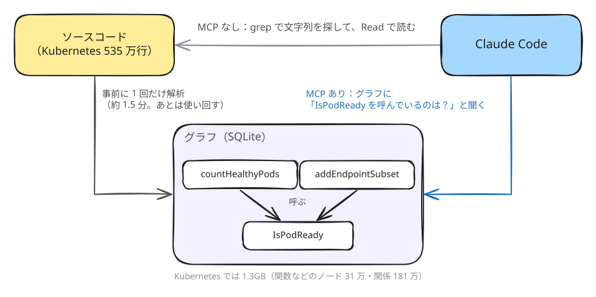
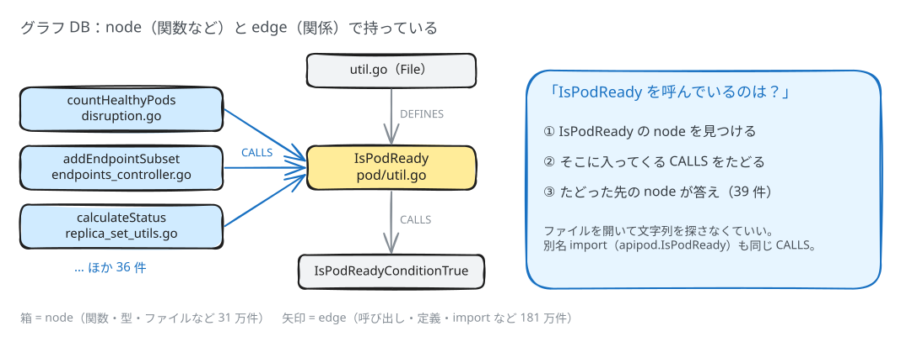

# コードをグラフDBで検索可能にする MCP は使うべきか
codebase-memory-mcp の論文では「トークンが約 10 分の 1 になる」、README ではそれ以上（412k → 3.4k）とされている。普段の使い方でも、本当にトークンと時間が減るのか？を検証した。

## codebase-memory-mcp とは

[codebase-memory-mcp](https://github.com/DeusData/codebase-memory-mcp) は、ソースコードを事前に解析して、「どの関数がどの関数を呼んでいるか」をグラフにして持っておく MCP サーバー。Claude Code は grep の代わりに、このグラフに問い合わせられる。





- データは **node と edge の 2 種類だけ**で持っている。
  - **node**：関数、メソッド、構造体、変数、ファイルなど。場所と行番号、シグネチャ、doc コメントも持つ。
    
    | id     | label    | name                    | file_path                                       | start_line | end_line |
    | ------ | -------- | ----------------------- | ----------------------------------------------- | ---------- | -------- |
    | 380    | File     | util.go                 | pkg/api/v1/pod/util.go                          | 0          | 0        |
    | 287572 | Function | **IsPodReady**          | pkg/api/v1/pod/util.go                          | 297        | 299      |
    | 251197 | Function | countHealthyPods        | pkg/controller/disruption/disruption.go         | 921        | 937      |
    | 148678 | Function | addEndpointSubset       | pkg/controller/endpoint/endpoints_controller.go | 646        | 669      |
    | 155936 | Function | calculateStatus         | pkg/controller/replicaset/replica_set_utils.go  | 96         | 144      |
    | 287575 | Function | IsPodReadyConditionTrue | pkg/api/v1/pod/util.go                          | 312        | 315      |
    
  - **edge**：node 同士の関係。CALLS、IMPORTS、IMPLEMENTS、DEFINES など約 30 種類。
    
    | source_id | target_id  | type      | properties（一部）                                  |
    | --------- | ---------- | --------- | --------------------------------------------------- |
    | 380       | 287572     | DEFINES   | `{}`                                                |
    | 251197    | **287572** | **CALLS** | `{"callee": "apipod.IsPodReady", "line": 931}`      |
    | 148678    | **287572** | **CALLS** | `{"callee": "podutil.IsPodReady", "line": 654}`     |
    | 155936    | **287572** | **CALLS** | `{"callee": "podutil.IsPodReady", "line": 111}`     |
    | 287572    | 287575     | CALLS     | `{"callee": "IsPodReadyConditionTrue", "line": 298}` |
    

「`IsPodReady` を呼んでいる関数は？」は、以下のようなクエリで引ける。

```sql
SELECT n.name, n.file_path
FROM edges e JOIN nodes n ON n.id = e.source_id
WHERE e.target_id = 287572   -- IsPodReady
  AND e.type = 'CALLS';
```

## やったこと


- **対象**：Kubernetes（Go、約 535 万行）。インデックスの作成は約 1.5 分、サイズは 1.3GB。
- **比較方法**：公式の手順どおりに MCP、スキル、hooks を入れて、６つの質問を「MCP なし」と「MCP あり」で各 3 回ずつ聞いた。モデルは Opus 5.5 で、毎回新しいセッションで実行した。また、MCP を使うように自分でも指示するかしないかで２パターンの検証を行った。
  - ラウンド 1：使うかどうかは Claude に任せる
  - ラウンド 2：CLAUDE.md に「コードの構造を調べるときは、grep より先に MCP を使うこと」と書く
- **質問**：実際の開発で使いそうな質問を 6 つ。グラフDBを活用できそうな質問も混ぜた。
  - 関数の使われ方
  - リファクタ候補
  - 処理の流れ
  - 影響範囲（引数を足すと、どこを直す必要があるか）
  - 未使用コード
  - インターフェースの実装一覧
- **計測**：
  - トークン数と時間：Claude Code のログ（`claude -p` の出力）から集計した。トークン数は入力・出力・キャッシュの読み書きをすべて足したもの（サブエージェントの分も含む）。
  - 質：どちらの条件の回答か伏せたうえで、別の Claude がソースで裏取りしながら 1〜5 点をつけた。

## 結果


**Opus + Claude Code では、ほぼ効果がなかった。** 任せるとほとんど使われず、CLAUDE.md で「使って」と指示すると毎回使うが、重くなるだけで質も上がらなかった。Opus は grep がもう十分うまいので、グラフの出番は「リポジトリ全体を総当たりで調べる質問」くらいしかなかった。


|                  | MCP なし | MCP あり（任せる）   | MCP あり（CLAUDE.md で指示） |
| ---------------- | ------ | ------------- | --------------------- |
| MCP を使った回数       | —      | **18 回中 3 回** | **18 回中 18 回**        |
| 総トークン            | 340 万  | 531 万（1.56 倍） | 607 万（1.79 倍）         |
| コスト（参考）          | $4.74  | $5.75（1.21 倍） | $6.33（1.34 倍）         |
| 時間（未使用コードの問題を除く） | 722 秒  | 750 秒         | 858 秒                 |
| 質の平均（5 点満点）      | 4.39 / 4.22 | 4.17     | 3.89                  |


MCP なしは 1 回分のログを両ラウンドで使い回している。質だけは、ラウンドごとに MCP ありの回答と混ぜて採点し直したので、ラウンド 1 では 4.39、ラウンド 2 では 4.22 になった（同じ回答でも採点のたびに少しぶれる）。質は同じラウンドの中で比べる。

## **分析・考察**

### MCPを使うかどうか任せると：ほとんど使われない

- 公式のスキルには「呼び出し元を探すとき」「影響範囲を調べるとき」「リファクタ候補」「未使用コード」など、使うべき場面が書いてある。6 問中 5 問がこれに当たるのに、**スキルが起動したのは未使用コードの 1 問だけ**だった。
- 影響範囲や実装一覧といったグラフが得意そうな質問でも、Opus は **grep 1〜2 回で正解のほぼ全部にたどり着いた**。
- 使わなくても、MCP やスキルの説明が毎回コンテキストに載るので、**1 リクエストあたり約 1,700 トークンが上乗せ**された。

### MCPを使うように指示すると：毎回使うが、重くなるだけ

- 18 回すべてで、グラフを見たあとに結局 grep や Read でコードを読みに行った。
  - MCP なし：grep → grep → grep（3 手、32 秒）
  - MCP あり：MCP ツールの読み込み → グラフ検索 → 呼び出し元の追跡 → コード取得 → grep × 4（8 手、48 秒）
- Claude Code はやりとりのたびに会話全体を読み直すので、総トークンの約 9 割はこの読み直しが占める。**手数が増えると、そのぶんトークンも増える。**
- 質はむしろ下がった。リファクタ候補の質問は 3.67 → 2.33。グラフで「同じ名前の関数が複数あるもの」を探すやり方に引っ張られたうえ、そのクエリがメソッドを対象にしていなかった。そのため、各コントローラーのワーカーループ（メソッド）のような「形が同じ処理」の重複を見落とした。

### 効いた場面もあった

未使用コードを探す質問では、351 秒 → 105〜157 秒（2.2〜3.3 倍速い）になった。
  - MCP なしでは、関数名ごとに grep を何百回も回していた。グラフなら「呼び出し元が 0 件の関数」をクエリで出せる。
  - ただし、どちらのラウンドでもメソッドの未使用（`ByLogging` など）を 3 回とも見落とした。グラフの結果は裏取りが必要。

### 論文と結果が違う理由

- **比べた相手が違う**：公式のベンチマークは、ファイルを 1 つずつ開いて読むやり方と比べている。今の Opus は、狙いを絞った grep で必要なところだけを読む。
- **質問が違う**：論文の質問は、グラフで答えやすい形のものが中心。
- **測ったものが違う**：論文の「速い」は、ツール 1 回の応答速度の話。調査全体にかかる時間ではない。
- 論文の中でも、回答の質は MCP なしのほうが高かった（0.92 vs 0.83）。

## 結論

- **普段使いで常に入れておく価値は薄い。** 任せるとほとんど使われず、毎回トークンが上乗せされるだけ。CLAUDE.md で使わせても、重くなるだけで質は上がらない。
- **使いどころは「リポジトリ全体の総当たり調査」**（未使用コードの掃除など）。そのときだけ使って、結果は grep で裏取りする。
- **今回は試していない条件**：小さいモデル（Sonnet / Haiku）、長いセッション、自分たちのリポジトリ。こうした条件では結果が変わる可能性がある。

## 注意点

- 各条件 3 回だけなので、傾向をつかむための検証。統計的な結論ではない。
- コストはサブスクリプションで実行したものを API 料金に換算した参考値。

## 詳しく

- ラウンド 1（使うかどうかは任せる）のレポート：[round1/report.md](round1/report.md)
- ラウンド 2（CLAUDE.md で使うよう指示）のレポート：[round2/report.md](round2/report.md)